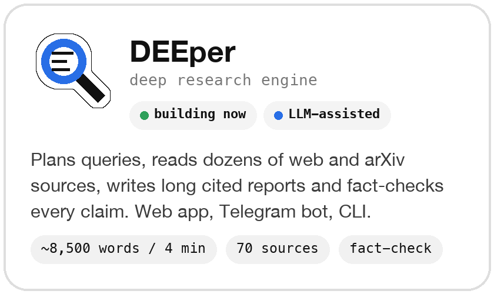
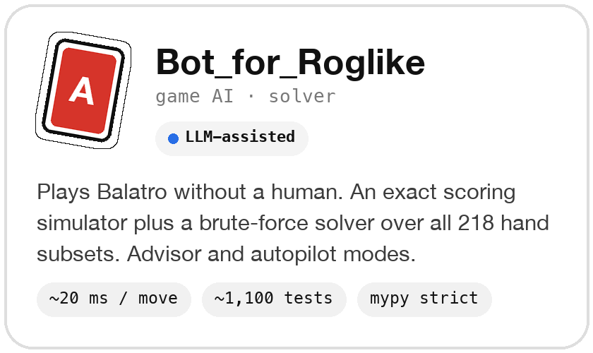
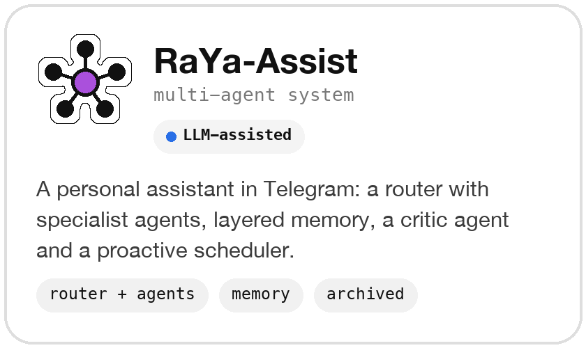
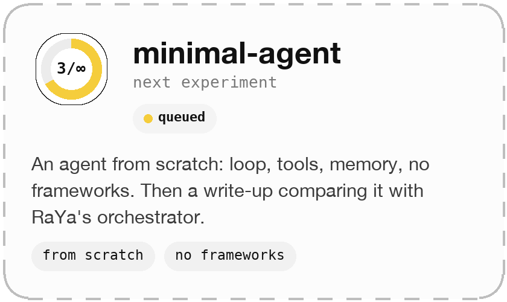

<p align="center">
  
</p>

<p align="center">
  <i>AI researcher · currently: math → next: agentic systems · building weird and creative things along the way</i>
</p>

```text
$ python train.py --model me --epochs inf

Epoch 1/inf  ━━━━━━━━━━━━━━━━━━━━  Python & ML fundamentals            loss: 1.90  ✓
Epoch 2/inf  ━━━━━━━━━━░░░░░░░░░░  Math for ML (linear algebra,       loss: 1.21  ← you are here
                                    calculus, probability)
Epoch 3/inf  ░░░░░░░░░░░░░░░░░░░░  Agentic systems: from "built with  loss: ----  [queued]
                                    LLM help" to "built from scratch"
```

---

## 📦 Dataset
*What I'm feeding myself right now.*

- **Studying now:** math for ML — linear algebra, calculus, probability
- **Building now:** [DEEper](https://github.com/MrBoomer1981/DEEper) — a deep research engine that writes long cited reports
- **Up next:** agentic systems — tool use, planning, memory, evaluation
- **Always running:** creative side projects, because that's where I learn the most

## 🏗️ Architecture
*My stack.*


<!-- Add only what you actually use: NumPy, PyTorch, pandas, scikit-learn, Jupyter, ... -->

## 🧾 Checkpoints
*Saved models, a.k.a. my projects.*

<p align="center">
  <a href="https://github.com/MrBoomer1981/DEEper"></a>
  <a href="https://github.com/MrBoomer1981/Bot_for_Roglike"></a>
  <a href="https://github.com/MrBoomer1981/RaYa-Assist"></a>
  <a href="#-next-experiments"></a>
</p>

> **LLM-assisted** = written with LLM help. I go through each one until I can explain every line.

## 📊 Eval metrics
*Honest numbers.*

```text
projects_shipped         : 3
agent_systems_built      : 2    # with LLM help; rebuilding from scratch is the plan
balatro_bot_win_rate     : 1/16 (mean ante 4.2)   # first measurement, improving
tests_in_largest_project : ~1,100
bugs_fixed_at_3am        : too many
```

## ⚙️ Hyperparameters
```yaml
learning_rate: high
batch_size: 1          # one thing at a time
curiosity: 1.0
dropout: 0.0           # never skip a study session
```

## 🔬 Next experiments
- [ ] Implement gradient descent and backprop from scratch in NumPy (to connect the math to the models)
- [ ] Write short notes on each math topic I finish, in my own words
- [ ] Rebuild a minimal agent from scratch: loop, tools, memory, no frameworks
- [ ] Compare it with RaYa's orchestrator and write up the differences

## 📡 Inference
*How to reach me.*

[](https://t.me/byaven)
[](mailto:tretyakovgleb63@gmail.com)

---

<p align="center">
  
  
</p>
